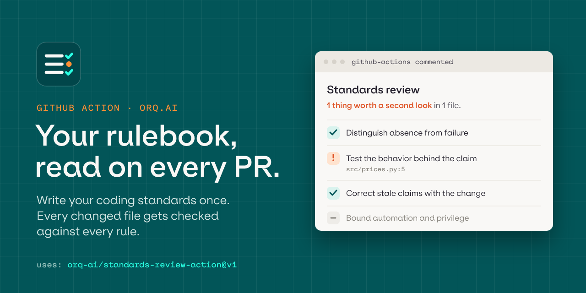

<p align="center">
  
</p>

<p align="center">
  <a href="https://github.com/orq-ai/standards-review-action/actions/workflows/test.yml"></a>
  <a href="LICENSE"></a>
  
</p>

Every team has a `CODING_STANDARDS.md`. Most of them are read once, at onboarding, by the person who wrote them.

**standards-review-action** reads yours on every pull request. For each changed file it asks a small classifier model on the [orq.ai](https://orq.ai) router one question per rule (pass, violation, or not applicable), then leaves **one** comment on the PR and keeps it up to date as you push.

It is a second opinion, not a gatekeeper. By default it never blocks a merge.

## Quickstart

1. Put a numbered list of rules in `CODING_STANDARDS.md` ([format](#write-your-rulebook)).
2. Add an `ORQ_API_KEY` repository secret. The key needs the `classify.execute` permission.
3. Add `.github/workflows/standards-review.yml`:

```yaml
name: Standards review

on:
  pull_request_target:
    types: [opened, synchronize, reopened, ready_for_review]

concurrency:
  group: standards-review-${{ github.event.pull_request.number }}
  cancel-in-progress: true

permissions:
  contents: read
  pull-requests: write

jobs:
  review:
    # Forks and Dependabot cannot read this repository's secrets.
    if: github.event.pull_request.head.repo.full_name == github.repository && github.actor != 'dependabot[bot]' && !github.event.pull_request.draft
    runs-on: ubuntu-latest
    timeout-minutes: 30
    steps:
      # Base checkout: the rules come from main, so a PR cannot rewrite the rules it is judged by.
      - uses: actions/checkout@v4
        with:
          ref: ${{ github.event.pull_request.base.sha }}
      - uses: orq-ai/standards-review-action@v1   # or pin a commit SHA
        with:
          api-key: ${{ secrets.ORQ_API_KEY }}
```

That's it. The next PR gets a comment.

## What you'll see

One comment per PR, edited in place on every push. It opens with the line you actually need:

| Situation | Headline |
| --- | --- |
| Violations found | **2 things worth a second look** in 1 file. |
| Some files could not be read | **Nothing flagged in what I could read**, but 1 item stayed out of reach; see Incomplete coverage. |
| Clean | **All clear.** 6 files read against 4 rules, nothing to flag. |
| Only lockfiles and images changed | **Nothing to judge.** Every changed file was ignored or had a binary diff. |
| The run broke | **Could not finish this review.** followed by the error. A crash never reads as a pass. |

Below the headline: a per-rule table (pass / violations / not applicable / score), the list of violations with file and line, and anything it skipped. Violations also show up as warning annotations on the diff and in the job summary.

## Write your rulebook

Any line shaped like `N. **Title.** Explanation` is a rule. Everything else (headings, prose, examples, sub-bullets) is context for humans and is ignored.

```markdown
1. **Distinguish absence from failure.** Do not turn a failed call into an empty result.
2. **Test the behavior behind the claim.** A behavior change comes with a test that fails without it.
```

Rules that work well are concrete enough to spot in a diff. "Write clean code" will be `not_applicable` forever; "Never catch bare `Exception` without re-raising" will not. A starter set lives in [`examples/CODING_STANDARDS.md`](examples/CODING_STANDARDS.md).

## Inputs

| Input | Default | What it does |
| --- | --- | --- |
| `api-key` | required | orq.ai API key with `classify.execute` |
| `standards` | `CODING_STANDARDS.md` | Path to the rulebook in the checkout |
| `model` | `orq/decider-4b` | Classifier model on the orq.ai router |
| `endpoint` | `https://api.orq.ai/v3/router/classify` | Classify endpoint (HTTPS only) |
| `ignore` | lockfiles, images, PDFs, CSV/JSONL/Parquet, notebooks, archives, video, fonts | Newline-separated globs; replaces the defaults |
| `extra-ignore` | empty | Newline-separated globs on top of the ignore list |
| `max-calls` | `80` | Model-call budget per run; the rest is reported as incomplete coverage |
| `fail-on-findings` | `false` | Turn it from advisor into gate: fail on violations or incomplete coverage |
| `comment` | `true` | Create and update the PR comment |
| `comment-author` | `github-actions[bot]` | Login that owns the comment, if you pass another token |
| `github-token` | `github.token` | Token for fetching the PR and commenting |
| `base` / `head` | PR base / head SHA | Commits to compare, for non-PR events |

**Outputs:** `violations`, `incomplete`, `exit-code` (0 clean, 1 findings, 2 crash), `report-json`, `report-markdown`. Keep the reports with:

```yaml
      - uses: actions/upload-artifact@v4
        if: always()
        with:
          name: standards-review
          path: ${{ runner.temp }}/standards-review.*
```

## How it judges

- **One file per call.** A file's diff is judged on its own, so a violation points at its file. Diffs over about 26k tokens are split into as few calls as fit; files never share a call.
- **Same view as "Files changed".** It diffs from the merge base, so commits that landed on `main` after you branched are not your problem.
- **Fails closed.** A missing, extra, or malformed verdict from the model is an error, never a silent pass.
- **Bounded.** 1 MB per file diff, one diff line must fit in a chunk, and `max-calls` caps spend. Anything it had to skip is listed, not hidden.
- **PR code is data.** It is fetched and diffed, never executed. The scripts run from the action ref and the rules from the base checkout.

## Things worth knowing

**Most verdicts are "not applicable".** That's expected: a rule about tests rarely applies to a YAML change. Scores are per rule over pass + violation only, so watch the counts, not just the percentage.

**Line numbers are approximate.** They point at the start of the judged diff chunk, not the exact offending line.

**`pull_request` instead of `pull_request_target`?** Works too, but forks get no secrets, and a PR could edit the rulebook it is judged against.

**Getting `HTTP 403 Missing permission: classify.execute`?** Your orq.ai key exists but cannot call the classify endpoint. Grant it that permission in the orq.ai workspace, or use a key that has it.

## Run it locally

Python 3.10+, standard library only.

```bash
export ORQ_API_KEY=...
python3 scripts/standards_review.py --base origin/main --head HEAD --standards CODING_STANDARDS.md
python3 scripts/standards_review.py --base origin/main --head HEAD --dry-run   # chunking only, no API calls
python3 -m unittest discover -s tests
```

## License

[MIT](LICENSE), from the research team at [orq.ai](https://orq.ai).
